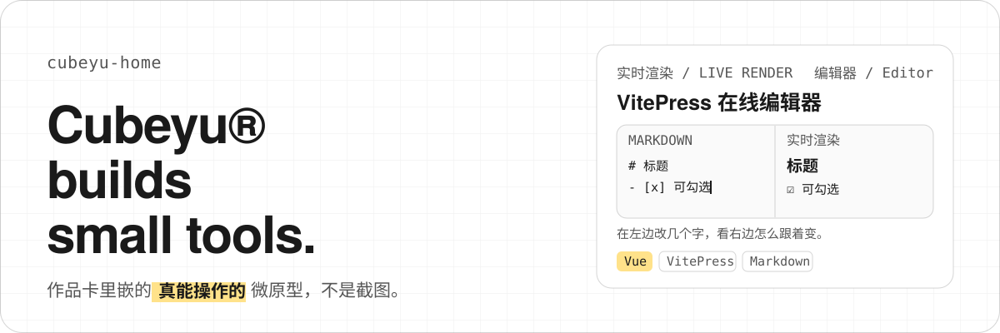
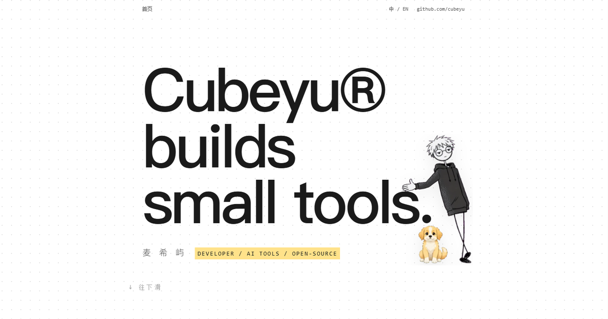
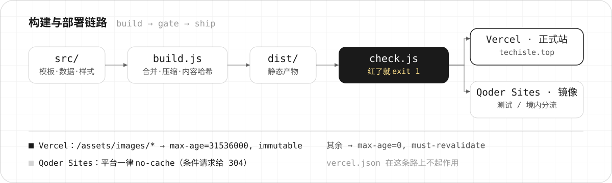

<p align="center">
  
</p>

**cubeyu-home** 是 [techisle.top](https://techisle.top/) 的源码：一个零运行时依赖的单页个人主页，
视觉语言取自瑞士编辑式极简风。它的核心主张只有一句——作品卡里嵌的是**真能操作的 CSS/JS 微原型**，
不是截图。

<p align="center">
  
</p>

## 线上

| 用途 | 地址 | 来源 |
| --- | --- | --- |
| 正式站 | [techisle.top](https://techisle.top/) | Vercel，从 `master` 构建 |
| 镜像 | [cubeyu-home on Qoder Sites](https://cubeyu-gnqulu2a87c.qoder.website/) | 测试与境内分流 |
| 本地 | `http://localhost:4173` | `npm run serve` |

## 为什么它不一样

**卡里是能跑的东西。** `src/js/demos/` 注册微原型，卡片按 `data-demo` 挂载；注册表与文件互相对账，
多一个或少一个都会在门禁里红。所以"能操作"不是文案，是被断言盯着的状态。

**幕布只由 CSS 退场。** 开屏那块 `fixed` 层靠自己的 `animation-fill-mode: forwards` 滑走并
`visibility: hidden`，JS 不参与摘它。后果是：脚本出错、被拦截、模块加载失败，首屏都不会被一块
永久盖住的层困住。装饰失效的正确后果是"没有装饰"，而不是"没有内容"。

**零运行时依赖。** `package.json` 的 `dependencies` 是空对象，而且这条被钉成断言。第三方包只允许
出现在 `devDependencies`——目前是 `lightningcss` 与 `terser`，都只在构建期用。

**没有打包器。** `src/js/` 下的 ES module 原样拷进产物，浏览器按真实模块图加载；`modulepreload`
清单由文件系统算出来，不手写，所以加一个 js 文件不需要记得改模板。

## 跑起来

```bash
npm ci
npm run check      # 构建 + 产物契约门禁
npm run serve      # 起本地服务 → http://localhost:4173
```

| 命令 | 做什么 |
| --- | --- |
| `npm run build` | 产出 `dist/`：合并压缩 CSS、给图片名加内容哈希、原样拷贝模块与静态根文件 |
| `npm run check` | `npm run build` 再跑 `check.js` 的产物契约门禁，任何一条红就 `exit 1` |
| `npm test` | `node --test test/`。**需要先构建**——其中 29 条断言读 `dist/` 里的产物 |

## 构建与部署

<p align="center">
  
</p>

Vercel 侧的缓存分层写在 `vercel.json`：`/assets/images/*` 因为文件名带内容哈希，拿
`public, max-age=31536000, immutable`；其余文件保持 `max-age=0, must-revalidate`，这样改版后
不会出现"旧样式配新 HTML"。

`favicon.ico`、`apple-touch-icon.png`、`og-image.png` **故意不进哈希**：前一个是浏览器不读 HTML
就会请求的默认路径，后两个的名字被外部按 URL 缓存——改名等于把已经抓走的预览悬空，而且没人通知你。

## 目录

| 路径 | 职责 |
| --- | --- |
| `src/templates/index.html` | 首页模板，`{{TOKEN}}` 由构建期替换 |
| `src/data/` | 内容层：`site.js` 站点身份、`projects.js` 作品卡、`skills.js`、`copy.js` |
| `src/styles/` | 分文件样式，构建期合并成单个 `app.css` |
| `src/js/` | 原生 ES module，按渐进增强分层 |
| `src/js/demos/` | 卡内微原型的注册表与实现 |
| `src/images/` | 图集与插画源文件（构建时加内容哈希） |
| `src/static/` | 原样拷到产物根的稳定文件名资产（图标与分享图） |
| `src/lib/build-utils.js` | 构建期工具，含 `esc()`：对 `null`/`undefined` 直接抛 |
| `build.js` · `check.js` · `serve.js` | 构建 · 门禁 · 本地静态服务 |
| `test/` | `node --test` 契约测试 |
| `docs/superpowers/` | 设计文档与里程碑记录（内部过程记录，不是使用文档） |

## 约束

改这个仓库时请守住下面几条，它们都有对应断言：

- `package.json` 的 `dependencies` 必须保持 `{}`。
- 只有 `src/styles/tokens.css` 的声明里允许出现字面色值。
- 卡片数量**不写死**在任何代码、注释或文案里。
- 开屏幕布由 CSS 自己退场，JS 不许摘它。
- 禁用 JS 时页面仍必须可读、可导航——渐进增强，不是降级兜底。

## 已知限制

- 只有首页加一个极简 404，没有子页面、RSS、留言板。
- 主题只有明暗两套，不做多主题切换。
- 仓库尚未附许可证文件。

---

作者：麦希屿 · [github.com/cubeyu](https://github.com/cubeyu) · cubeyu@aliyun.com
